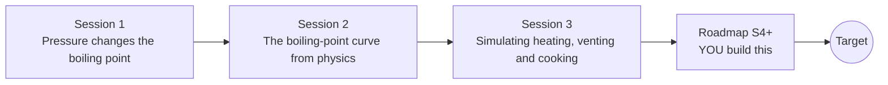

# openpressurecooker

[](https://github.com/KrunalPanchal1995/openpressurecooker/actions/workflows/ci.yml)   [](https://colab.research.google.com/github/KrunalPanchal1995/openpressurecooker/blob/main/sessions/session-01/lesson.ipynb) [](https://krunalpanchal1995.github.io/openpressurecooker/)

**Why a pressure cooker cooks faster, from boiling point to a simulation you can check.**

openpressurecooker teaches how pressure raises the boiling point of water and why that speeds up cooking, using only Python and a browser.

- **Start from a kitchen question.** Session 1 needs only a table and the idea of doubling per 10 degrees; no calculus.
- **See it move.** Every session ships a slider app that runs in the browser, with labelled graphs.
- **Know you got it right.** Each session ends with a checkpoint that prints PASS or FAIL against hand calculations and steam-table values.
- **Build the missing half.** The repo stops at Session 3 on purpose; the roadmap shows the path to the Target.

[Target](#the-target) · [Who is this for](#who-is-this-for) · [Quick start](#quick-start) · [Sessions](#sessions) · [Roadmap](#roadmap) · [Contribute](#contribute) · [Explainer PDF](docs/explainer.pdf)

> **This repo is incomplete on purpose.** Sessions 1 to 3 are here and fully working. The finished Target below is a preview of what the community can build next. We show you the path, not the code. Sessions 4 and up are yours.

## The Target

An animated cooker cross-section: the weighted valve starts to rock when the pot reaches its set pressure, a dial shows the gauge pressure, and the water temperature plateaus near 120 C. Underneath, a progress race compares lentils in the cooker with the same lentils in an open pot: the cooker finishes at about 18 minutes, the open pot at about 46. Your goal over the coming sessions: build that animated race yourself, then add heat loss, cooling and food with an inside.


*Target: an animated cooker with gauge, and a cooking race against an open pot*


*Target still: cooker finished while the open pot is about one third done*

Try it live:

- [Math Visual Studio: properties of substances (Atlas S52)](https://krunalpanchal1995.github.io/studio/#atlas?ch=S52&ex=1)
- [Math Visual Studio: thermodynamic cycles (Atlas S55)](https://krunalpanchal1995.github.io/studio/#atlas?ch=S55&ex=1)

How the Target was made is shown only as a path in [promo/roadmap.md](promo/roadmap.md).

## Who is this for
**middle school to higher secondary (levels 2-4).** Topic area: Everyday Life and Practical Knowledge.

Prerequisites:

- Basic algebra, powers and the idea of a logarithm (Session 2 reminds you; Session 1 needs none).
- Python 3.10 or newer; if `python --version` works, you are ready. PRIMER.md explains the rest.
- No prior thermodynamics, GitHub or cooking-science experience is needed.

New to Python? Read [PRIMER.md](PRIMER.md) first (10 minutes).

## Quick start

No installation knowledge needed. You need [Git](https://git-scm.com/downloads) and [Python 3.10+](https://www.python.org/downloads/) (Windows: tick "Add Python to PATH"). On Mac and Linux type `python3` wherever this page says `python`.

```bash
git clone https://github.com/KrunalPanchal1995/openpressurecooker.git
cd openpressurecooker
python start.py 1
```

`start.py` creates a private environment, installs what is needed and runs Session 1 with its checkpoint. Next: `python start.py 2`, `python start.py 3`, or `python start.py test` to check everything. Only a checkpoint: `python start.py check 1`.

Four lines turn the idea of Session 2 into a result (they work as they are): Save it as `try.py` and run it with `python start.py run try.py` (this uses the private environment, where NumPy is installed):

```python
import numpy as np
R, L = 8.314, 40700.0                        # gas constant and latent heat of water (J/mol)
p = 201.325                                    # 100 kPa above the air, as absolute kPa
T = 1 / (1 / 373.15 - R * np.log(p / 101.325) / L)
print(round(T - 273.15, 1))                    # -> 120.6 degrees C
```

Every session also opens in your browser with sliders (no install): [live apps](https://krunalpanchal1995.github.io/openpressurecooker/). Or use the Colab badge above for the notebook.

## Sessions

| # | Session | Model level | Time | Live app |
|---|---|---|---|---|
| 1 | [Pressure changes the boiling point](sessions/session-01/README.md) | Level 1: conceptual interactive model | 60 min | [open](https://krunalpanchal1995.github.io/openpressurecooker/session-01/) |
| 2 | [The boiling-point curve from physics](sessions/session-02/README.md) | Level 2: mathematical engineering model | 75 min | [open](https://krunalpanchal1995.github.io/openpressurecooker/session-02/) |
| 3 | [Simulating heating, venting and cooking](sessions/session-03/README.md) | Level 3: simulation and validation | 90 min | [open](https://krunalpanchal1995.github.io/openpressurecooker/session-03/) |

Each session follows the same six steps: A real-world problem, B concept and theory, C visual explanation, D interactive simulation, E worked example and experiment, F assessment and design challenge. Each ends with `checkpoint.py`, which prints `PASS` or `FAIL` against reference numbers. Session 3 also contains the real-world mini-project: **Choose the whistle time for lentils**.

## Architecture



| Folder or file | What is inside |
|---|---|
| `sessions/` | three sessions: README (A-F), `lesson.py`, notebook, live app, exercises, activity sheet, checkpoint |
| `promo/` | the Target: media, live links, and the roadmap (path only) |
| `docs/` | `explainer.tex` and the built `explainer.pdf` |
| `tests/` | runs every lesson and checkpoint headless |
| `start.py` | one command to set up and run anything |
| `QUALITY.md`, `RUBRIC.md` | the quality checklist and the scoring rubric |
| `.github/` | CI, PDF build, Pages deploy, issue and PR templates |

## Roadmap

| Milestone | What you will build | Difficulty |
|---|---|---|
| Session 4: Real steam properties | A saturation-pressure function with a temperature-dependent latent heat or a fitted equation, compared with tabulated data. | intermediate |
| Session 5: Heat loss and natural release | A simulation extended with a heat-loss term and a cool-down phase after the heat is off. | intermediate |
| Session 6: Food with an inside | A radial diffusion solver coupled to the cooking rate. | advanced |
| Session 7: Altitude and the open pot | The open-pot model with atmospheric pressure as an input, and a cooker setting that restores the sea-level time. | intermediate |
| Session 8: Relief devices in the model | A second relief valve set above the regulator that opens in the blocked case, with the pressure traced over time. | advanced |

Full detail with a checkpoint per milestone: [promo/roadmap.md](promo/roadmap.md).

## Contribute
New to GitHub? Read [CONTRIBUTING.md](CONTRIBUTING.md); it starts from zero. Pick an issue labelled `good first issue`. Translations into Hindi, Telugu, Tamil and Malayalam are welcome.

<details>
<summary>Development</summary>

```bash
python start.py test        # runs every lesson and checkpoint
```
Lessons use `# %%` cell markers so they open as notebooks in VS Code. See [QUALITY.md](QUALITY.md) for the standard every session meets.
</details>

## License
MIT. See [LICENSE](LICENSE). Media in `promo/media` is (c) Krunal Panchal, CC BY 4.0.

## Acknowledgments
Part of the [PAN IIT OSS](https://hellofoss.tech-iitb.org/projects) open-source teaching collection, modelled on the structure of [openspline](https://github.com/openspline/openspline). Built on ideas from the Math Visual Studio at https://krunalpanchal1995.github.io/studio/.
