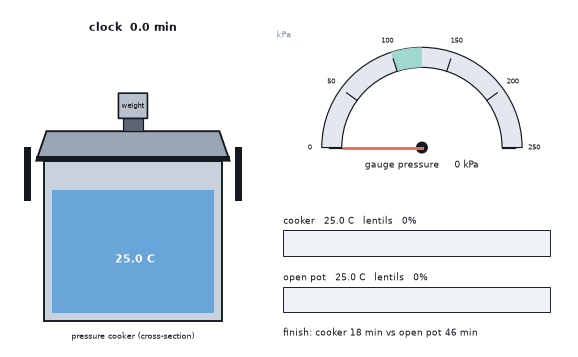
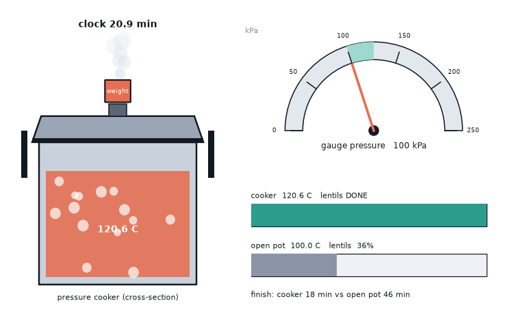
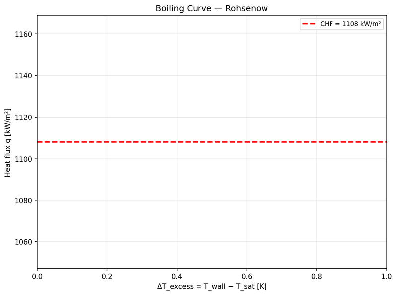
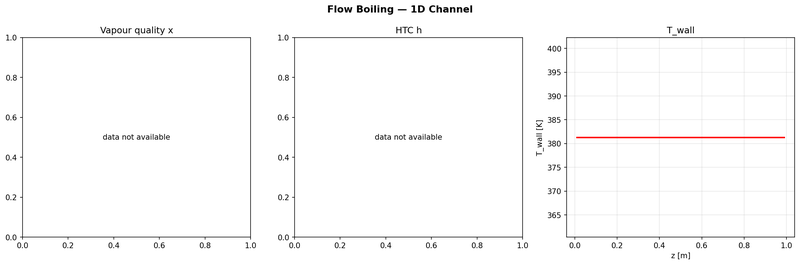

# What you are building toward

An animated cooker cross-section: the weighted valve starts to rock when the pot reaches its set pressure, a dial shows the gauge pressure, and the water temperature plateaus near 120 C. Underneath, a progress race compares lentils in the cooker with the same lentils in an open pot: the cooker finishes at about 18 minutes, the open pot at about 46. Your goal over the coming sessions: build that animated race yourself, then add heat loss, cooling and food with an inside.

*Target: an animated cooker with gauge, and a cooking race against an open pot*

*Target still: cooker finished while the open pot is about one third done*

*From the CFD core project: a boiling curve*

*From the CFD core project: flow boiling*

These results come from a private reference build. The code is not published; the roadmap shows the path so you can build your own.

Live links:

- [Math Visual Studio: properties of substances (Atlas S52)](https://krunalpanchal1995.github.io/studio/#atlas?ch=S52&ex=1)
- [Math Visual Studio: thermodynamic cycles (Atlas S55)](https://krunalpanchal1995.github.io/studio/#atlas?ch=S55&ex=1)
