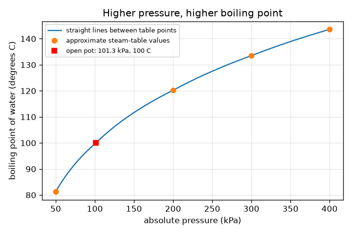
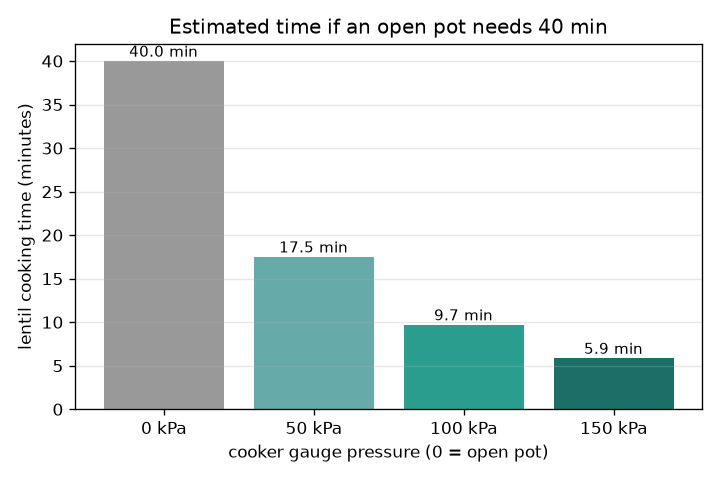

# Session 1: Pressure changes the boiling point

*Level 1 (conceptual interactive model) · about 60 minutes · openpressurecooker*

> This is a simplified educational model. It is not a validated design tool and must not be used for real structures, electrical installations, vehicles, industrial processes or medical decisions.

**Prerequisites**

- Know that water boils at 100 degrees C in an open pot.
- You have read PRIMER.md and run `python start.py 1` once.

**Learning objectives.** After this session you can:

- Explain why water boils at a higher temperature when the pressure is higher.
- Explain how a pressure cooker traps steam and holds a higher pressure.
- Read the boiling point from a pressure table and a graph, using gauge and absolute pressure correctly.
- Use the doubling-per-10-degrees rule of thumb to estimate a cooking time.

## A. Real-world problem
Lentils take about 40 minutes in an open pot and a much shorter time in a pressure cooker, on the same flame. The cooker does not make the flame hotter. What does the sealed lid change? This is a simplified teaching model for understanding, not a guide for using or altering real equipment: never modify, block or remove the valves of a real cooker.

## B. Concept and theory
Water boils when bubbles of steam can form against the pressure around the water. At the pressure of the air at sea level, 101.3 kPa, that happens at 100 degrees C. If the pressure is higher, bubbles need a hotter liquid, so the boiling point rises. In an open pot the steam escapes, so the pressure stays at one atmosphere and the water cannot get hotter than 100 degrees C however big the flame (extra heat only makes more steam). A cooker has a sealed lid and a weighted valve: steam collects, the pressure rises until the valve lifts, and then it holds a set pressure. A gauge reads the pressure above the air, so absolute pressure = gauge + 101.325 kPa. We read boiling points from a small table of approximate steam-table values. Chemistry (softening, breaking down) goes faster when it is hotter; a rule of thumb says the rate roughly doubles for each 10 degrees C, so speed factor = 2 to the power (T - 100) / 10. It is a rule of thumb, not an exact law.

| Symbol | Meaning | Unit |
|---|---|---|
| P_gauge | pressure above the air, as shown by a gauge | kPa |
| P_abs | absolute pressure = gauge + 101.325 | kPa |
| T | boiling point at that pressure | degrees C |
| f | cooking speed factor compared with 100 degrees C | no unit |
| t_open, t_cooker | cooking time in an open pot and in the cooker | min |

**Assumptions**

- Boiling points between the table values are found by straight lines on a log-pressure scale (approximate).
- Table values are approximate steam-table values.
- The food is at the temperature of the boiling water, and doubling per 10 degrees C is only a rule of thumb.
- Teaching model only; not for designing or changing real equipment.

$$ P_{\mathrm{abs}}=P_{\mathrm{gauge}}+101.325\ \mathrm{kPa} $$

$$ f=2^{(T-100)/10} $$

$$ t_{\mathrm{cooker}}=\frac{t_{\mathrm{open}}}{f} $$

## C. Visual explanation
The first figure plots boiling point against absolute pressure: the curve rises quickly at first and then flattens, so the first extra 100 kPa buys about 20 degrees C and the next 100 kPa only about 13. The open pot is the point at 101.3 kPa and 100 degrees C. The second figure is a bar chart of the estimated lentil time for cooker settings of 0, 50, 100 and 150 kPa gauge, for a recipe that needs 40 minutes in an open pot: 40, 17.5, 9.7 and 5.9 minutes.

*Boiling point against absolute pressure: higher pressure, higher boiling point, with a flattening curve.*

*Estimated lentil time for a 40 minute open-pot recipe at four cooker settings.*

## D. Interactive simulation
Run the lesson (`python start.py 1`), then open the live app: [Session 1: pressure and boiling point](https://krunalpanchal1995.github.io/openpressurecooker/session-01/) (or `app.html` in this folder). Drag the gauge pressure and watch the water temperature and the boiling-point curve move. Change the open-pot time and see the cooker time follow.

**Challenge.** With the open-pot time left at 40 minutes, get the estimated cooker time down to 15 minutes or less.

## E. Worked example and experiment
**Problem.** A cooker holds 100 kPa gauge. What is the absolute pressure, the boiling point, the speed factor, and the time for a recipe that needs 40 minutes in an open pot?

1. Absolute pressure = 100 + 101.325 = 201.3 kPa.
2. The table has 200 kPa at 120.2 degrees C and 300 kPa at 133.5 degrees C, so 201.3 kPa is just above 200: boiling point about 120.4 degrees C.
3. Speed factor = 2^((120.4 - 100) / 10) = 2^2.04 = 4.12.
4. Time = 40 / 4.12 = 9.7 minutes.

**Answer.** Absolute pressure 201.3 kPa, boiling point about 120.4 degrees C, about 4.1 times faster, so about 9.7 minutes.

**Experiment.** Safe experiment, in an ordinary open pot only: boil water and measure the temperature with a kitchen thermometer; it should read about 100 degrees C at sea level and a little less on a hill or in a city well above sea level, because the air pressure is lower. Do not try to measure or change anything inside a pressure cooker. The model is a table plus a rule of thumb, so it shows the idea but real cooking times also depend on the food, its size and how the heat gets inside it.

## F. Assessment and design challenge
**Question type A: Conceptual.** Why can an open pot never get the water hotter than about 100 degrees C, even on a huge flame? What does the extra heat do instead?

Hint

Think about where the steam goes and what the pressure around the water is.

Step-by-step solution

In an open pot the pressure stays at one atmosphere because the steam escapes. At that pressure the water boils at 100 degrees C, and any extra heat goes into turning more water into steam (latent heat), not into raising the temperature. To get hotter water the pressure has to be raised, which is what the sealed cooker does.

**Question type B: Numerical.** A cooker holds 150 kPa gauge. Find the absolute pressure, the boiling point from the table, the speed factor and the time for a recipe that needs 60 minutes in an open pot.

Hint

Add 101.325 first, then interpolate between 200 and 300 kPa.

Step-by-step solution

Absolute = 251.3 kPa. The boiling point is between 120.2 (200 kPa) and 133.5 degrees C (300 kPa): about 127.7 degrees C. Speed factor = 2^(27.7/10) = 6.8. Time = 60 / 6.8 = about 8.8 minutes. Sanity check: for the same 40 minute recipe, 150 kPa gives 5.9 minutes against 9.7 at 100 kPa, so more pressure means a hotter pot and a shorter time, as expected.

**Question type C: Graph and simulation interpretation.** On the boiling-point graph, how much does the boiling point rise between 101 and 200 kPa, and between 200 and 300 kPa? What does the change in steepness tell you about adding more pressure?

Hint

Read the table points: 100, 120.2 and 133.5 degrees C.

Step-by-step solution

From 101.3 to 200 kPa it rises about 20 degrees C (100 to 120.2), roughly 0.20 degrees C per kPa. From 200 to 300 kPa it rises 13.3 degrees C, about 0.13 degrees C per kPa. The curve flattens, so each extra kPa buys less temperature: a much higher pressure (and a stronger, more dangerous vessel) gives diminishing returns.

**Question type D: Design and optimisation challenge.** Design: choose a gauge pressure (in whole 5 kPa steps) so that a 40 minute open-pot recipe takes 12 minutes or less, and say what limits you from simply choosing a much higher pressure.

Hint

You need a speed factor of at least 40 / 12 = 3.33; find the temperature for that, then the pressure.

Step-by-step solution

A factor of 3.33 needs a boiling point of at least 100 + 10 log2(3.33) = 117.4 degrees C. The table gives that at about 82 kPa gauge (11.8 min at 82 kPa, 12.07 at 80 kPa), so choose 85 kPa (about 11.4 minutes). Limits: a higher pressure needs a stronger vessel and a heavier valve, spends more energy, can overcook or break up the food, and the benefit flattens with pressure. Real cookers have fixed, tested settings; this is a teaching calculation, never a reason to change a valve.

Score yourself with [RUBRIC.md](../../RUBRIC.md). Print the [activity sheet](activity_sheet.md) to work on paper.

## Common misconceptions
| Common misconception | What is actually true |
|---|---|
| A pressure cooker works because its flame is hotter. | The flame is the same. The sealed lid raises the pressure, so the water boils at a higher temperature, and the food is hotter. |
| Water always boils at 100 degrees C. | Only at 101.3 kPa (sea-level air pressure). It is lower with lower pressure (mountains) and higher with higher pressure (cooker). |
| A gauge reading of 0 means no pressure. | A gauge reads pressure above the air. Gauge 0 means one atmosphere, 101.3 kPa absolute. |
| The cooker cooks faster because steam is hotter than water. | The water and steam are at the same temperature when they are in equilibrium; what matters is that the whole pot is at 120 degrees C instead of 100. |

## Glossary
- **boiling point**: the temperature at which a liquid turns to vapour freely; depends on pressure
- **absolute pressure**: pressure measured from a perfect vacuum; includes the air
- **gauge pressure**: pressure above the surrounding air; gauge 0 is one atmosphere
- **kPa**: kilopascal, 1000 pascals; one atmosphere is about 101.3 kPa
- **rule of thumb**: a rough, easy rule that is useful but not exact

## Finish
1. Do the three coding tasks in [exercises.md](exercises.md).
2. Run `python start.py 1` again after your changes. It ends with the checkpoint; when it prints `PASS`, you are done. (Checkpoint only: `python start.py check 1`.)

Next: [Session 2](../session-02/README.md)
