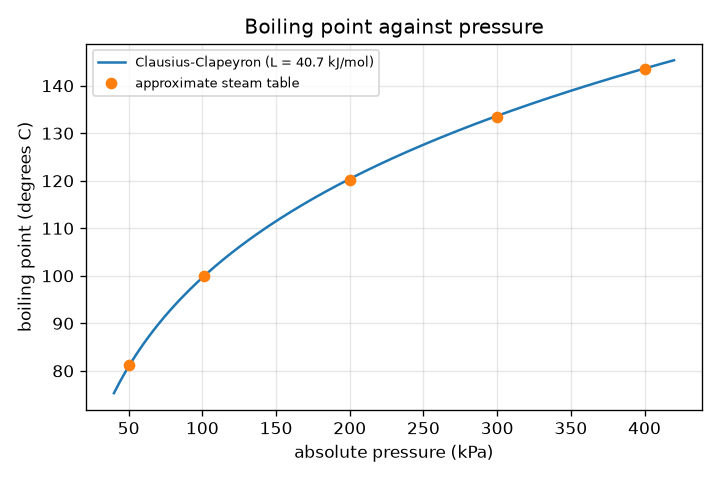
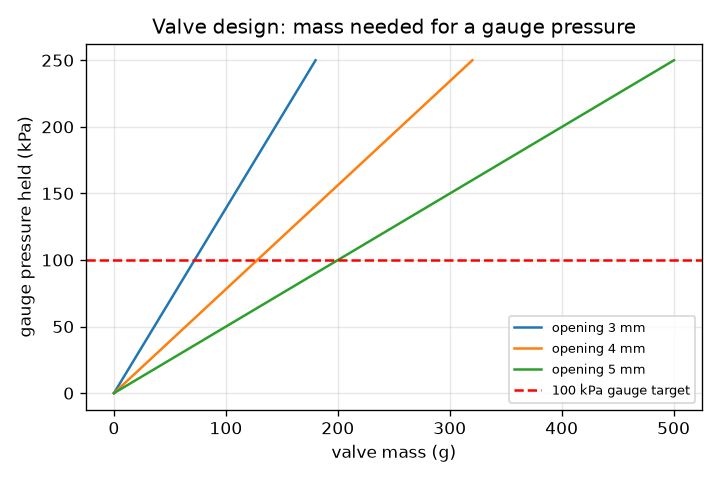

# Session 2: The boiling-point curve from physics

*Level 2 (mathematical engineering model) · about 75 minutes · openpressurecooker*

> This is a simplified educational model. It is not a validated design tool and must not be used for real structures, electrical installations, vehicles, industrial processes or medical decisions.

**Prerequisites**

- Session 1: gauge and absolute pressure, boiling point against pressure.
- Natural logarithm ln and the exponential: reminders are given in Section B.

**Learning objectives.** After this session you can:

- Use the Clausius-Clapeyron relation to calculate the boiling point at a given pressure, and its inverse.
- Compare the calculation with approximate steam-table values and state the error.
- Distinguish gauge from absolute pressure and use the Q10 rule of thumb for cooking rate.
- Solve a design problem: choose a valve weight that holds 100 kPa gauge.

## A. Real-world problem
Session 1 read boiling points from a table. Where do the table numbers come from, and how heavy must the weight on a cooker's valve be to hold the pressure at 100 kPa above the air? We derive the boiling-point curve from one physical relation and then size the weight. This is a simplified educational calculation, not a design method: never modify, block or remove the valves of real equipment.

## B. Concept and theory
At the boiling point, liquid and vapour are in equilibrium, and the pressure and temperature are linked. Treating the vapour as an ideal gas, ignoring the small volume of the liquid, and taking the molar latent heat L of vaporisation as constant gives the Clausius-Clapeyron relation: ln(P2/P1) = (L/R)(1/T1 - 1/T2), with temperatures in kelvin. For water, L is about 40.7 kJ/mol near 100 degrees C, R = 8.314 J/(mol K), and the reference point is P1 = 101.325 kPa at T1 = 373.15 K. Solving for T2 gives the boiling point at a pressure P2, and solving for P2 gives the vapour pressure at a temperature. The relation is approximate: L changes a little with temperature and steam is not perfectly ideal, so we compare with a few approximate steam-table values (about 100 degrees C at 101.3 kPa, about 120 degrees C at about 200 kPa absolute). Gauge pressure = absolute - 101.325 kPa; physics uses absolute. For cooking, the rule of thumb is that the rate roughly doubles for each 10 degrees C rise (a Q10 of 2). A weighted valve lifts when the pressure force on its opening equals the weight: P_gauge x A = m g, with A = pi d^2 / 4.

| Symbol | Meaning | Unit |
|---|---|---|
| P1, P2 | absolute pressures | kPa |
| T1, T2 | boiling temperatures at P1 and P2 | K |
| L | molar latent heat of vaporisation of water, about 40.7 | kJ/mol (40700 J/mol) |
| R | gas constant 8.314 | J/(mol K) |
| Q10 | factor by which a rate grows for +10 degrees C, taken as 2 | no unit |
| m, d, A | valve mass, opening diameter and its area | kg, m, m^2 |
| g | gravitational acceleration 9.81 | m/s^2 |

**Assumptions**

- Latent heat L is constant (40.7 kJ/mol) over the range.
- The vapour behaves as an ideal gas and the liquid volume is negligible.
- Steam-table comparison values are approximate.
- Q10 = 2 is a rule of thumb, not a law.
- The valve opens when pressure force equals weight (no friction or spring).

$$ \ln\frac{P_2}{P_1}=\frac{L}{R}\left(\frac{1}{T_1}-\frac{1}{T_2}\right) $$

$$ T_2=\left(\frac{1}{T_1}-\frac{R}{L}\ln\frac{P_2}{P_1}\right)^{-1} $$

$$ P_{\mathrm{abs}}=P_{\mathrm{gauge}}+101.325\ \mathrm{kPa},\qquad f=Q_{10}^{(T-100)/10} $$

$$ P_{\mathrm{gauge}}A=mg,\qquad A=\frac{\pi d^2}{4}\ \Rightarrow\ m=\frac{P_{\mathrm{gauge}}A}{g} $$

## C. Visual explanation
The first figure draws the Clausius-Clapeyron curve and the approximate steam-table points on one graph; the points sit within about 0.4 degrees C of the curve between 50 and 400 kPa. The second figure shows the valve mass needed against the gauge pressure for three opening sizes: a smaller opening needs a lighter weight for the same pressure, and the red dashed line marks the 100 kPa gauge target, hit at 72 g, 128 g and 200 g for 3, 4 and 5 mm openings.

*Clausius-Clapeyron boiling-point curve with approximate steam-table points.*

*Valve mass needed for a gauge pressure, for three opening sizes.*

## D. Interactive simulation
Run the lesson (`python start.py 2`), then open the live app: [Session 2: boiling point and valve weight](https://krunalpanchal1995.github.io/openpressurecooker/session-02/) (or `app.html` in this folder). Change the valve mass and the opening diameter. Watch the gauge pressure, the Clausius-Clapeyron boiling point and the dot on the curve change, and compare the dot with the grey steam-table points.

**Challenge.** Hold the cooker within 3 kPa of 100 kPa gauge.

## E. Worked example and experiment
**Problem.** Find the boiling point at 100 kPa gauge from Clausius-Clapeyron, the cooking rate factor, and the valve mass needed for a 4 mm opening.

1. Absolute pressure P2 = 100 + 101.325 = 201.325 kPa, so P2 / P1 = 1.9868 and ln = 0.6865.
2. (R / L) ln = 8.314 / 40700 x 0.6865 = 1.4024e-4 per K. 1/T1 = 1/373.15 = 2.6799e-3 per K.
3. 1/T2 = 2.6799e-3 - 1.4024e-4 = 2.5397e-3, so T2 = 393.76 K = 120.6 degrees C. (The approximate steam-table value near 200 kPa is 120.2 degrees C.)
4. Rate factor = 2^((120.6 - 100) / 10) = 4.17, so a 40 minute recipe is about 9.6 minutes.
5. Valve: A = pi (0.004)^2 / 4 = 1.2566e-5 m^2. m = 100000 x 1.2566e-5 / 9.81 = 0.1281 kg = 128 g.

**Answer.** Boiling point about 120.6 degrees C (steam table about 120.2), rate factor 4.17, and a 4 mm opening needs about 128 g of valve weight.

**Experiment.** Safe experiment in an open pot: measure the boiling temperature of water with a kitchen thermometer and compare with 100 degrees C minus about 1 degree for every 300 m of height (a rough rule), noting that weather also changes the pressure. Never test valves or weights on real equipment. The model differs from reality because L is not exactly constant, steam is not an ideal gas, real valves have friction, springs and tolerances, and dissolved salt changes the boiling point slightly.

## F. Assessment and design challenge
**Question type A: Conceptual.** Why must the Clausius-Clapeyron relation use absolute temperature in kelvin and absolute pressure, not the gauge reading?

Hint

What happens to ln(P2/P1) if P1 or P2 is zero or negative, and what does 1/T mean at 0 degrees C?

Step-by-step solution

The relation comes from the ideal gas law and an energy balance, which are about the actual amount of gas and its actual temperature measured from absolute zero. A gauge reading of 0 would give ln(0) and an unphysical result, though one atmosphere is really 101.3 kPa. Temperatures in degrees C could be zero or negative, which would make 1/T meaningless, so kelvin must be used.

**Question type B: Numerical.** Use Clausius-Clapeyron to find the boiling point at 50 kPa absolute (for example high on a mountain). Compare with the approximate table value 81.3 degrees C.

Hint

ln(50/101.325) = -0.7064. Use 1/T2 = 1/373.15 - (R/L) ln(P2/P1).

Step-by-step solution

(R / L) ln = 8.314 / 40700 x (-0.7064) = -1.443e-4. 1/T2 = 2.6799e-3 + 1.443e-4 = 2.8242e-3, T2 = 354.1 K = 80.9 degrees C. The table says 81.3, so the error is about -0.4 degrees C, a good agreement for a constant-L model.

**Question type C: Graph and simulation interpretation.** From the first figure, in which range of pressure does the Clausius-Clapeyron curve and the steam-table points agree best, and where do they differ most? Suggest why.

Hint

The curve is fitted exactly at 101.3 kPa, where the latent heat was chosen.

Step-by-step solution

They agree exactly at 101.3 kPa (the reference point) and within 0.2 degrees C at 200, 300 and 400 kPa; the largest difference is at 50 kPa, about 0.4 degrees C. The model fixes L at its value near 100 degrees C and ignores the small change of L and the non-ideal steam, which matter more as the pressure moves away from the reference.

**Question type D: Design and optimisation challenge.** Design: a cooker has a 5 mm valve opening. Choose a valve mass that holds 100 kPa gauge, say how the gauge pressure changes if the mass is 10 percent too heavy, and give the new boiling point.

Hint

Pressure is proportional to the mass for a fixed opening; then recompute the boiling point from the new absolute pressure.

Step-by-step solution

A = pi (0.005)^2 / 4 = 1.9635e-5 m^2, so m = 100000 x 1.9635e-5 / 9.81 = 0.2002 kg = 200 g. If the mass is 10 percent heavier (220 g), the gauge pressure becomes 110 kPa (proportional), absolute 211.3 kPa, and the boiling point rises from 120.6 to about 122.1 degrees C. Trade-off: heavier weight means hotter and faster cooking but a higher load on the pot; a real valve is a certified safety part with tolerances, so this is only a calculation, not a reason to change a valve.

Score yourself with [RUBRIC.md](../../RUBRIC.md). Print the [activity sheet](activity_sheet.md) to work on paper.

## Common misconceptions
| Common misconception | What is actually true |
|---|---|
| Gauge pressure can be put straight into the formula. | The formula needs absolute pressure; add 101.325 kPa to a gauge reading first. |
| The latent heat L is a number that never changes. | L of water falls as the temperature rises; treating it as constant is the main reason the curve is approximate. |
| Doubling per 10 degrees C is an exact law. | It is a rule of thumb for many reactions near room to cooking temperatures; Session 3 shows the more careful Arrhenius form. |
| A bigger valve opening needs less weight for the same pressure. | The opposite: a bigger opening gives a bigger force at the same pressure, so it needs a heavier weight. |

## Glossary
- **Clausius-Clapeyron relation**: the equation linking the boiling temperature and the pressure of a liquid
- **latent heat**: heat needed to turn a liquid into vapour at constant temperature
- **kelvin**: absolute temperature scale; 0 degrees C is 273.15 K
- **Q10**: the factor by which a rate grows for each 10 degrees C rise
- **ideal gas**: a gas whose molecules do not attract each other; a good simple model for steam

## Finish
1. Do the three coding tasks in [exercises.md](exercises.md).
2. Run `python start.py 2` again after your changes. It ends with the checkpoint; when it prints `PASS`, you are done. (Checkpoint only: `python start.py check 2`.)

Next: [Session 3](../session-03/README.md)
