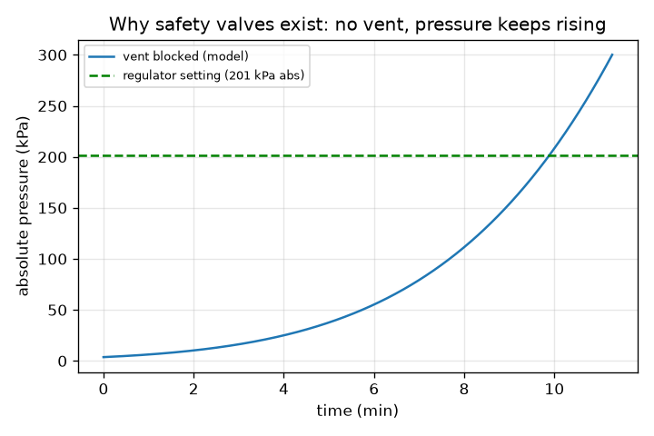
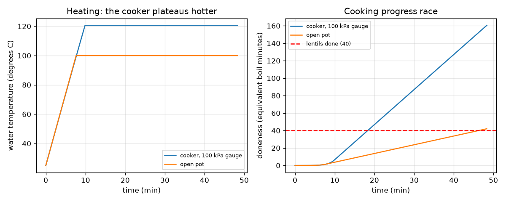
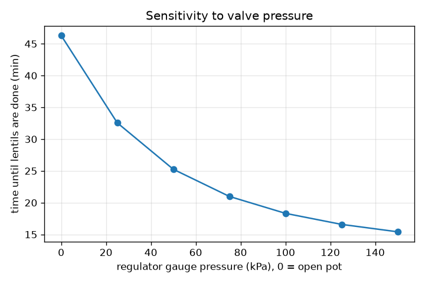

# Session 3: Simulating heating, venting and cooking

*Level 3 (simulation and validation) · about 90 minutes · openpressurecooker*

> This is a simplified educational model. It is not a validated design tool and must not be used for real structures, electrical installations, vehicles, industrial processes or medical decisions.

**Prerequisites**

- Session 2: Clausius-Clapeyron and gauge versus absolute pressure.
- Heat capacity: energy = mass x specific heat x temperature change (reminder in Section B).

**Learning objectives.** After this session you can:

- Build a lumped model of heating, venting at the regulator pressure and cooking progress.
- Validate it with an energy balance, a hand formula, a time-step test and Clausius-Clapeyron values.
- Compare an open pot with a cooker and test the sensitivity to valve pressure and heater power.
- Explain a blocked-vent failure case and why independent safety valves exist.

## A. Real-world problem
How long does a cooker take to heat up, how much water does it lose, and how much faster does it really cook lentils than an open pot? We build a model with three parts and then try to break it: validate it against things we can calculate by hand, ask how sensitive it is, and see what a blocked vent would do in the model. This is a simplified educational model, not a design tool, and no instructions follow from it: never modify, block or remove the valves of real equipment.

## B. Concept and theory
Lumped model: one uniform water temperature T. The pot holds water of mass m and has heat capacity C = m cp + C_pot. Heating: net power eta P (heater power P and efficiency eta). The headspace of volume V is full of saturated steam, an ideal gas: its mass is m_s = psat(T) V M / (R T), with psat from Clausius-Clapeyron. The water-pot-steam enthalpy is H(T) = C T + L_mass m_s(T), so heating follows dH/dt = eta P until T reaches the regulator boiling point T_b = Tsat(P_atm + gauge). Then the regulator vents: the user turns the heat down to a hold power eta h P (h = 0.25), all of it makes steam that leaves, so the pressure and T stay fixed and water is lost at eta h P / L_mass kg per second. Cooking: an Arrhenius rate k(T) = exp(-Ea/R (1/T - 1/T_ref)) equals 1 at 100 degrees C; doneness D is the integral of k over time in equivalent boil minutes, and lentils are done at D = 40. We choose Ea = 82.4 kJ/mol, which gives a rate that about doubles for 10 degrees C near 100 degrees C (an illustrative value, not a measured one). The open pot is the same model with pressure 101.325 kPa and no sealed headspace. Failure case: if the vent is blocked, the heater keeps adding energy, T keeps rising and the pressure follows psat(T), rising at dP/dt = (psat L / (R T^2)) dT/dt. Real cookers have independent safety valves for exactly this reason.

| Symbol | Meaning | Unit |
|---|---|---|
| T | uniform water temperature | K |
| C | heat capacity of water plus pot, 4886 | J/K |
| eta, P, h | heater efficiency (0.8), heater power (1000), hold fraction (0.25) | -, W, - |
| V, m_s | headspace volume (3 L) and its steam mass | m^3, kg |
| L_mass | latent heat per kg, L / M = 2.26e6 | J/kg |
| Ea, k, D | activation energy, relative rate, doneness | J/mol, -, equivalent minutes |
| gauge, T_b | regulator setting and boiling point at that pressure | kPa, K |

**Assumptions**

- One uniform temperature; no heat loss to the room; fixed efficiency.
- Steam in the headspace is pure, saturated and an ideal gas (the air has already been pushed out); latent heat constant at 40.7 kJ/mol.
- The user turns the heat down to 25 percent when boiling starts, in both pots.
- Cooking is a single rate process with Arrhenius k and Ea chosen to give Q10 near 2; food has no inside or outside.
- Teaching model only, not a design or safety tool.

$$ H(T)=C\,T+L_{\mathrm{mass}}\,m_s(T),\qquad m_s=\frac{p_{\mathrm{sat}}(T)\,V\,M}{R\,T} $$

$$ \frac{dH}{dt}=\eta P\ \ (T<T_b),\qquad \dot m_{\mathrm{vent}}=\frac{\eta h P}{L_{\mathrm{mass}}}\ \ (T=T_b) $$

$$ k(T)=\exp\!\left[-\frac{E_a}{R}\left(\frac{1}{T}-\frac{1}{373.15}\right)\right],\qquad D=\int k\,\frac{dt}{60} $$

$$ t_{\mathrm{heat}}\approx\frac{C\,(T_b-T_0)}{\eta P},\qquad \frac{dP}{dt}=\frac{p_{\mathrm{sat}}L}{R\,T^2}\,\frac{dT}{dt} $$

## C. Visual explanation
The first figure has two panels. Left: the water temperature rises together in both pots, then the open pot stops at 100 degrees C while the cooker climbs to the plateau at 120.6 degrees C (it boils later, at 9.9 minutes against 7.7, because it must also fill the headspace and reach a higher temperature). Right: the doneness races; after boiling starts the cooker's line rises about 4 times as fast as the open pot's. The second figure plots the finishing time against the regulator setting: 46.3 minutes for the open pot, then 32.6, 25.3, 21.0, 18.3, 16.6 and 15.4 minutes for 25 to 150 kPa gauge. The third figure is the failure case: with the vent blocked, the pressure passes the regulator setting at 9.9 minutes and reaches 300 kPa absolute 83 seconds later.

*Failure case in the model: with no vent, pressure rises without limit.*

*Temperature and doneness against time for the cooker (100 kPa gauge) and the open pot.*

*Finishing time against regulator pressure (0 = open pot).*

## D. Interactive simulation
Run the lesson (`python start.py 3`), then open the live app: [Session 3: cooker versus open pot](https://krunalpanchal1995.github.io/openpressurecooker/session-03/) (or `app.html` in this folder). Move the time slider and watch the cooker and the open pot race. Switch to the temperature and doneness graphs, change the regulator pressure and the heater power, and then open the blocked-vent view.

**Challenge.** Make the cooker start venting within 6 minutes while holding at least 115 degrees C.

## E. Worked example and experiment
**Problem.** For 1 kg of water, a 1000 W heater at 80 percent efficiency, a pot heat capacity of 700 J/K, a 3 L headspace and a 100 kPa gauge regulator, find the hand heating time from 25 degrees C to boiling, the steam in the headspace, and compare with the simulation.

1. C = 1 x 4186 + 700 = 4886 J/K. T_b = 393.76 K = 120.61 degrees C, so the rise is 95.61 K.
2. Hand heating time = 4886 x 95.61 / (0.8 x 1000) = 584 s = 9.73 minutes.
3. Steam in the headspace at 120.6 degrees C: m_s = 201325 x 0.003 x 0.018015 / (8.314 x 393.76) = 3.32 g.
4. Latent energy to make it: 3.32e-3 x 2.26e6 = 7.5 kJ, which takes 7.5e3 / 800 = about 9 s more.
5. The simulation gives boiling at 9.90 minutes (594 s): 584 s + about 10 s, within 2 percent of the hand formula, and the energy balance closes to better than 1e-6.

**Answer.** Hand estimate 9.73 minutes, simulation 9.90 minutes (the headspace steam costs about 10 s); 3.32 g of steam; the cooker then finishes the lentils at 18.3 minutes against 46.3 minutes for the open pot.

**Experiment.** Safe experiment: time how long a litre of water takes to boil in an open kettle or pot and compare with C (100 - T0) / (eta P) using the rated power; the real time will be longer because of heat loss and because power is not all delivered. Do not experiment with pressure equipment. The model differs from a real cooker because of heat loss, the cooling time after heat-off (cooking continues), food with an inside and outside, the air in the pot at the start and the fact that the real valve rocks and cycles rather than holding a perfectly constant pressure.

## Real-world application and mini-project: Choose the whistle time for lentils
A recipe says lentils need 40 minutes of simmering in an open pot after it starts boiling. Your cooker's regulator can be set to different gauge pressures. Use `cooker_hold_minutes(40, gauge)` from Session 3 to find how many minutes the cooker must hold pressure (counted from when the regulator starts venting) for gauge settings of 50, 75, 100 and 150 kPa. Compare with the shortcut 40 divided by the Q10 speed factor, and say why the simulation gives a shorter time. This is a model for learning: real timings depend on the food, the quantity and the equipment, so follow the maker's instructions and never change a valve.

**Deliverable:** A script that prints the hold time for each gauge setting next to the Q10 shortcut, rounds each simulated time up to a whole-minute timer, and saves a bar chart of both.

**Success looks like:** At 100 kPa gauge the simulated hold time is 8.76 minutes (timer 9 minutes) against 9.6 minutes from the shortcut, and the other settings give 16.90, 11.97 and 4.98 minutes for 50, 75 and 150 kPa; you explain that the simulation credits the cooking done while the pot heats up.

## F. Assessment and design challenge
**Question type A: Conceptual.** Why does the cooker plateau at about 120.6 degrees C instead of continuing to heat up, and what happens to the extra energy once it reaches the plateau?

Hint

Where does steam go once the regulator opens, and what does it carry with it?

Step-by-step solution

Once the pressure reaches the regulator setting the valve lifts and lets steam out, so the pressure and the boiling point stay fixed. Extra energy does not raise the temperature: it makes steam from the water (latent heat), and that steam leaves and carries the energy away. The vent rate is the net power divided by the latent heat per kg, here 0.2 x 1000 / 2.26e6 = 0.089 g/s.

**Question type B: Numerical.** For 2 kg of water, a 1500 W heater at 80 percent efficiency, 700 J/K pot and a regulator at 100 kPa gauge, estimate the heating time with the hand formula, ignoring the headspace.

Hint

C = 2 x 4186 + 700. The rise is 393.76 - 298.15 K.

Step-by-step solution

C = 9072 J/K, rise 95.61 K, net power 1200 W. t = 9072 x 95.61 / 1200 = 723 s = 12.05 minutes. (The simulation including the headspace gives 12.15 minutes, within 1 percent.) Units: J/K x K / W = s. Sanity check: twice the water but 1.5 times the power takes longer than the 9.7 minutes of the worked example.

**Question type C: Graph and simulation interpretation.** On the doneness graph, estimate the slope of each pot's line after boiling starts, and use it to explain why the cooker finishes far sooner even though it boils later.

Hint

The slope is the Arrhenius rate k, 1 at 100 degrees C.

Step-by-step solution

In the open pot k = 1, so doneness grows 1 equivalent minute per minute. In the cooker k at 120.6 degrees C is 4.02, so the line is about 4 times as steep. The cooker even gets credit while heating up (doneness 6.2 at the moment it starts boiling, against 1.3 for the open pot). So it starts late by 2 minutes but gains about 3 equivalent minutes per minute, finishing at 18.3 minutes.

**Question type D: Design and optimisation challenge.** Design: choose a regulator setting and heater power so that the lentils are done in at most 20 minutes and the water loss stays below 60 g. Use the sensitivity tables from the lesson and state the trade-off.

Hint

Compare the rows: 75 and 100 kPa at 1000 W, and 100 kPa at 1500 W.

Step-by-step solution

At 100 kPa gauge and 1000 W the lesson gives 18.3 minutes and 45 g, which meets both limits. 75 kPa gives 21.0 minutes, too slow; 100 kPa at 1500 W is faster (15.5 minutes) but loses 72 g because the hold power is a fraction of the full power, so it breaks the 60 g limit. Trade-off: more pressure and power save time but lose more water and need a stronger vessel, and the model assumes the heat is turned down when boiling starts. This is an exercise about the model, not advice for using real equipment.

Score yourself with [RUBRIC.md](../../RUBRIC.md). Print the [activity sheet](activity_sheet.md) to work on paper.

## Common misconceptions
| Common misconception | What is actually true |
|---|---|
| More heater power makes the cooker hotter once it is venting. | Once the regulator is open, the temperature is fixed by the pressure; more power only makes steam leave faster. |
| A cooker's cooking speed-up is exactly the Q10 rule. | The Q10 rule gives 4.17 at 120.6 degrees C, the Arrhenius rate gives 4.02, and the heating-up phase changes the totals; the shortcut and the simulation differ by about 0.8 minutes here. |
| If a model matches one number it is validated. | Check several independent things: energy balance, a hand formula, a time-step test and reference values. |
| A blocked vent just makes the cooker run a bit hotter. | In the model the pressure keeps climbing about 1 kPa per second near 200 kPa absolute; that is why real cookers have independent relief devices. |

## Glossary
- **lumped model**: a model that uses one value, such as one temperature, for a whole object
- **enthalpy**: the heat content including latent heat, used for the energy balance
- **Arrhenius rate**: a rate that grows exponentially with temperature through an activation energy
- **activation energy**: the energy barrier (J/mol) that sets how strongly a rate depends on temperature
- **safety valve**: an independent relief device that opens if the pressure gets too high
- **energy balance**: the check that energy supplied equals energy stored plus energy carried away

## Finish
1. Do the three coding tasks in [exercises.md](exercises.md).
2. Run `python start.py 3` again after your changes. It ends with the checkpoint; when it prints `PASS`, you are done. (Checkpoint only: `python start.py check 3`.)

Next: the [roadmap](../../promo/roadmap.md). Session 4 is yours to build.
